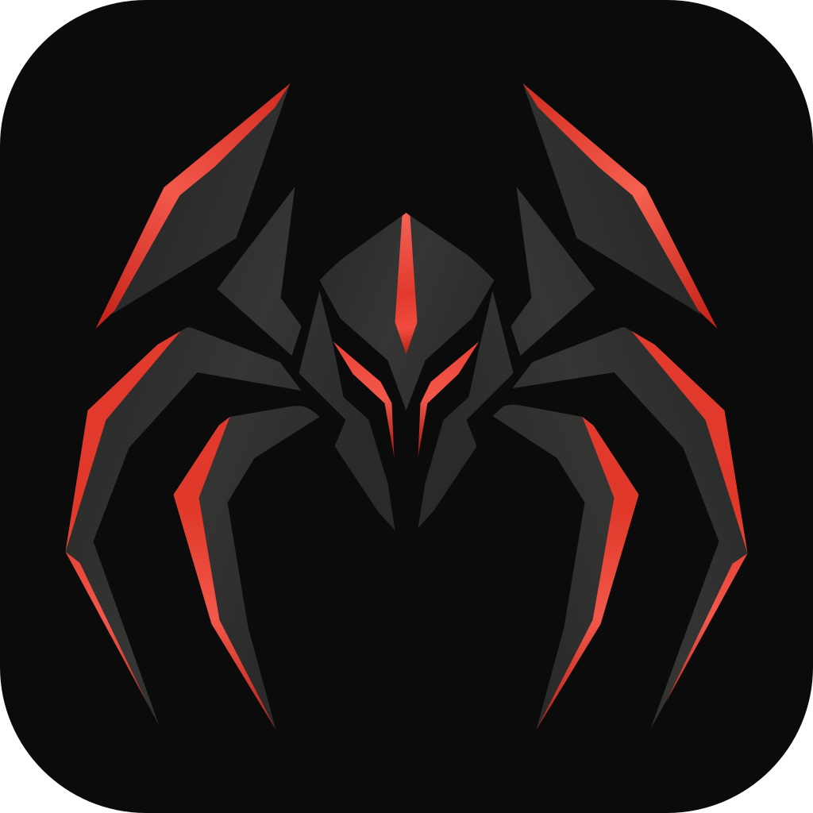

# Arach

Un seul launcher pour tous les jeux du PC : Steam, Epic Games, GOG, EA, Ubisoft Connect,
Riot Games, Battle.net, Xbox / Microsoft Store (Game Pass), Amazon Games, Rockstar, itch.io,
Heroic et Legendary, sur tous les disques, plus les jeux de console lancés avec leur émulateur :
DS, 3DS, Game Boy Advance, GameCube, Wii, PlayStation 1, 2 et 3, Switch, et tout ce que
RetroArch connaît. Écrit en Rust avec [Rune](https://github.com/anomalyco/rune)
(rendu GPU natif, pas de webview).

## Pages

- **Accueil** : le dernier jeu lancé en grand (illustration, logo, temps de jeu, Jouer), puis
  *Joués récemment*, *Favoris*, *Installés récemment*, et **Stockage** : une carte par disque avec
  l'espace libre et la part de chaque store.
- **Bibliothèque** : jaquettes ou liste détaillée (temps de jeu, dernière session, taille), par
  store, favoris, collection ou disque, triée par récence, nom, taille, temps de jeu ou note.
  **Filtres** combinables : statut, genres, année de sortie, collection, « jamais lancé », « pas
  lancé depuis 6 mois » ; chaque filtre actif est une pastille qui se retire d'un clic.
  **Sélection multiple** (bouton *Sélectionner* ou `Ctrl+clic`) : favori, collection, statut,
  masquer ou fusionner plusieurs jeux d'un coup. Les jeux possédés mais pas installés (Steam, Epic, GOG) suivent, grisés, avec un bouton
  **Installer** qui ouvre le store ; l'étagère *À installer* les regroupe.
- **Collections** : listes à soi (« À finir », « Coop », « Rétro »…) dans la barre latérale, en plus
  des Favoris. On y met un jeu en glissant sa jaquette (ou sa ligne) sur le nom de la collection,
  par clic droit, ou depuis sa fiche. Chaque collection est aussi une étagère de la Bibliothèque,
  où elle se renomme et se supprime (les jeux restent dans la bibliothèque).
- **Fiche d'un jeu** : illustration, description, studio, date de sortie, genres, Metacritic,
  temps de jeu, taille, dossier, options de lancement, et pour Steam : vérifier les
  fichiers, page du store, badge *Mise à jour en attente*. **Sauvegardes** : où le jeu les garde,
  une copie datée en un clic, et chaque copie restaurable. **Captures d'écran** : Steam, Xbox Game
  Bar et NVIDIA. **Succès Steam**, **Durée de vie** (HowLongToBeat, face au temps déjà joué),
  **Mods** (dossier, Nexus Mods) et **Désinstaller**, pour tous les stores. **Ma progression** : statut (non commencé, en cours,
  terminé, 100 %, abandonné), note sur 5, collections et notes libres. **Sessions mesurées** :
  les dernières sessions, le total et la semaine. **Versions** : le même jeu vu par plusieurs
  stores, chacun jouable, et *Séparer* quand ce n'est pas le même jeu. **Modifier** : nom,
  description, studios, date et genres corrigés à la main. **Images** : choisir la jaquette, le fond
  ou le logo parmi les résultats Steam et SteamGridDB, prendre un fichier, ou glisser une image sur
  la fiche (verticale : jaquette, horizontale : fond). La page prend la teinte de l'illustration du jeu.
- **Paramètres** : Général (après le lancement : réduire / rester / quitter, page d'ouverture,
  raccourcis), Bibliothèque (stores actifs, dossiers de jeux supplémentaires, analyse), Apparence
  (thème, couleur du bouton Jouer, taille des jaquettes, affichage), En ligne (jaquettes et
  descriptions, langue, clé SteamGridDB, cache), Jeux masqués, À propos. Bibliothèque › Consoles
  et Émulateurs : chaque console et l'émulateur qui la lance, trouvé seul ou choisi à la main.

## Raccourcis

| Touche | Action |
| --- | --- |
| *taper n'importe où* / `Ctrl+K` | Rechercher (sous-chaîne, initiales `kcd`, lettres dans l'ordre) |
| `Entrée` dans la recherche | Lancer le premier résultat |
| double-clic sur une jaquette | Jouer |
| clic droit sur un jeu | Jouer · Voir la fiche · Favori · Dossier · Collections · Modifier · Jaquette · Fusionner · Masquer |
| `Ctrl+clic` sur un jeu | Le sélectionner (puis `Ctrl+A` : tout, `Échap` : annuler) |
| glisser une jaquette sur la barre latérale | L'ajouter aux Favoris ou à une collection |
| `Alt+←` / `Échap` | Page précédente |
| `Ctrl+1` `Ctrl+2` `Ctrl+3` | Accueil, Bibliothèque, Favoris |
| `Ctrl+,` | Paramètres |
| `F5` / `Ctrl+R` | Relancer la détection |
| `F11` | Quitter ou reprendre le plein écran |

Glisser un `.exe`, un raccourci `.lnk` ou un lien `.url` sur la fenêtre l'ajoute à la bibliothèque.

## Détection

Chaque store est lu depuis ses propres manifestes, pas en parcourant les disques, donc les jeux
sont trouvés où qu'ils soient installés (C:, D:, F:…) en quelques millisecondes :

| Store | Source | Lancement |
| --- | --- | --- |
| Steam | `libraryfolders.vdf` → `appmanifest_*.acf` ; temps de jeu dans `userdata\*\config\localconfig.vdf` | `steam://rungameid/<id>` |
| Epic Games | `ProgramData\Epic\…\Manifests\*.item` | `com.epicgames.launcher://apps/…?action=launch` |
| GOG | `HKLM\…\GOG.com\Games` (DLC ignorés) | exécutable du jeu |
| Ubisoft | `HKLM\…\Ubisoft\Launcher\Installs` | `uplay://launch/<id>/0` |
| Riot Games | entrées `Riot Game <produit>.<patchline>` + `RiotClientInstalls.json` | `RiotClientServices --launch-product=…` |
| EA app | entrées de désinstallation EA avec `__Installer\installerdata.xml` | exécutable du jeu |
| Battle.net | entrées de désinstallation Blizzard (`--uid=`) | `Battle.net.exe --exec="launch <code>"` |
| Xbox / Microsoft Store | `Get-AppxPackage` (paquets du Store avec `MicrosoftGame.config` ou déclarés jeux) + noms du menu Démarrer | `shell:AppsFolder\<app>` |
| Amazon Games | entrées de désinstallation `Amazon Game Remover.exe -p <id>` | `amazon-games://play/<id>` |
| Rockstar | entrées de désinstallation du launcher (`-uninstall=<titre>`) | `Launcher.exe -launchTitleInFolder` |
| itch.io | reçus `.itch\receipt.json.gz` dans `%APPDATA%\itch\apps` et les emplacements de `butler.db` ; jaquette du reçu | exécutable du jeu |
| Heroic | `installed.json` de Legendary, GOG et Nile dans `%APPDATA%\heroic` | `heroic://launch?appName=…&runner=…` |
| Legendary | `~\.config\legendary\installed.json` | `legendary launch <app>` (ou l'exécutable) |
| Dossiers | chaque sous-dossier d'un dossier choisi dans Paramètres | exécutable trouvé dans le dossier |

**Consoles.** Les ROM et images disque sont cherchées dans les dossiers que les émulateurs
connaissent déjà (leur liste de jeux et leurs fichiers récents) et dans les dossiers ajoutés dans
Paramètres. Le titre et le code du jeu sont lus dans le fichier quand le format les contient :

| Console | Fichiers | Lu dans le fichier | Émulateur (sinon un cœur RetroArch) |
| --- | --- | --- | --- |
| Nintendo DS | `.nds` | titre, éditeur, icône (bannière) | DeSmuME |
| Nintendo 3DS | `.3ds` `.cci` `.cxi` `.cia` (décryptés) `.3dsx` ; mises à jour et DLC ignorés | titre, éditeur, icône (SMDH) | Azahar |
| Game Boy Advance | `.gba` | code (`AXVE`) | mGBA |
| GameCube / Wii | `.iso` `.gcm` `.rvz` `.wia` `.wbfs` `.ciso` `.gcz` | identifiant (`GZLE01`), titre | Dolphin (`-b -e`) |
| PlayStation | `.cue` `.bin` `.chd` `.pbp` `.m3u` ; pistes et disques 2+ regroupés | numéro de série (`SCUS-94455`) | DuckStation |
| PlayStation 2 | `.iso` `.chd` `.cso` | numéro de série (`SLUS-20062`) | PCSX2 |
| PlayStation 3 | dossiers de jeu (`PS3_GAME\PARAM.SFO`, `dev_hdd0\game`) + `games.yml` de RPCS3 | titre, série, icône, fond | RPCS3 (`--no-gui`) |
| Switch | `.nsp` `.xci` `.nsz` `.xcz` ; mises à jour et DLC ignorés | identifiant de titre (nom du fichier) | Ryujinx |
| RetroArch | les playlists `*.lpl` | nom libretro exact | le cœur de la playlist |

Une image `.iso` est reconnue par son en-tête (Nintendo, ou `SYSTEM.CNF` des PlayStation) ; une
image compressée (`.chd`, `.gcz`) par l'émulateur qui la liste ou le dossier où elle est (`PS2`,
`PSX`…). Les émulateurs sont trouvés dans Program Files, `%APPDATA%`, les dossiers de
l'utilisateur, près des ROM et à la racine des disques, ou choisis dans Paramètres › Bibliothèque ›
Émulateurs.

**Doublons.** Un jeu vu par deux stores dans le même dossier (un jeu EA acheté sur Steam)
n'apparaît qu'une fois, avec ses versions sur sa fiche ; le temps de jeu s'additionne. Si la
fusion automatique se trompe, *Séparer* garde la version à part ; à l'inverse, *Fusionner*
(sélection multiple ou clic droit › Fusionner avec…) réunit des jeux qu'Arach n'a pas
rapprochés. Les stores sont
analysés en parallèle ; la dernière analyse est gardée, donc la bibliothèque s'affiche dès la
première image puis se met à jour en arrière-plan.

### Temps de jeu

Seul Steam compte le temps de jeu ; Arach le mesure pour tous les jeux. Après un lancement, il
cherche toutes les 2 s (pendant 5 min au plus, le temps que le launcher démarre le jeu) un
processus lancé depuis le dossier du jeu, ou l'émulateur pour une ROM. Il le suit ensuite toutes
les 5 s. La session se ferme après 15 s sans aucun processus, ce qui laisse le temps à un launcher
de passer la main au jeu. Chaque session (début, fin) va dans `user.json`. Une session de moins
de 10 s ne compte pas. Le temps affiché et trié est le plus grand des deux : celui du store ou
celui mesuré. Arach doit rester ouvert : avec « Quitter Arach » après le lancement, rien n'est
mesuré.

### En cours, avant et après

Un jeu lancé apparaît dans la barre latérale (*En cours*) avec son temps de session et un bouton
**Arrêter**, qui remplace aussi **Jouer** sur sa fiche : il termine tous les processus du dossier
du jeu (ou l'émulateur), puis la session se ferme normalement.

Paramètres › Général › *Avant et après chaque jeu* règle, pour tous les jeux, ce qu'Arach fait
autour d'un lancement. Chaque fiche peut avoir ses propres réglages (« Propres à ce jeu ») :

| Action | Avant | Après la fermeture |
| --- | --- | --- |
| Script | `cmd /C <commande>` sans fenêtre, attendu 1 min au plus | lancé sans attendre |
| Fermer Discord | Discord, PTB ou Canary terminé | relancé réduit (via `Update.exe`) |
| Mode d'alimentation | `PowerSetActiveScheme` (modes lus sur le PC) | mode précédent |
| Résolution | écran principal, sans écrire dans le registre | résolution habituelle |

Les actions ne s'appliquent qu'aux jeux dont Arach voit la fermeture (pas aux raccourcis `.lnk`
ou `.url` ajoutés à la main). Avec des actions après le jeu, « Quitter Arach » devient « Réduire »
pour ce lancement ; si Arach est fermé pendant le jeu, il remet tout en place en partant.

**Discord Rich Presence** : le profil Discord affiche le jeu lancé depuis Arach (nom, store, durée,
image Steam si elle existe), quel que soit son store. Arach parle à Discord par son pipe local
(`\\.\pipe\discord-ipc-N`) sous une application Discord à soi : créez-la sur
discord.com/developers/applications (nommez-la « Arach ») et collez son *Application ID* dans
Paramètres › Général › Discord.

### Jeux possédés non installés

| Store | Source | Installer |
| --- | --- | --- |
| Steam | jeux des dossiers `appcache\librarycache` et ceux qui ont du temps de jeu dans `localconfig.vdf`, nommés et triés (jeux seulement) par `appcache\appinfo.vdf` | `steam://install/<id>` |
| Epic Games | `catcache.bin` du launcher (catalogue en base64), catégorie `games` | `com.epicgames.launcher://apps/…?action=install` |
| GOG | base de GOG Galaxy (`galaxy-2.0.db`, table `LibraryReleases`), DLC et packs ignorés | `goggalaxy://openGameView/<id>` |

Ces listes sont celles que les launchers gardent en cache : un jeu jamais affiché dans le
launcher peut manquer. Désactivable dans Paramètres › Bibliothèque.

## Illustrations et informations

Steam garde les illustrations de ses jeux en local (`appcache\librarycache`). Pour les autres,
Arach cherche le jeu par son nom sur l'API publique du Steam Store et télécharge jaquette,
illustration et logo, avec la description, le studio, la date de sortie et les genres. Les jeux
absents de Steam (League of Legends, Teamfight Tactics, Valorant…) sont cherchés de la même
façon sur l'Epic Games Store (jaquette, illustration, description, studio, date). Les jeux de
console sont cherchés par le code lu dans le fichier (`CPUF`, `GZLE01`, `SLUS-20062`…) :
jaquette sur GameTDB (DS, 3DS, GameCube/Wii, PS3) ou libretro-thumbnails, mise au format 2:3 sur
un fond flouté, et écran titre (ou capture) sur libretro-thumbnails, retrouvé via les bases
No-Intro et Redump de libretro (mises en cache 30 jours) ou le nom exact du fichier. La jaquette
fournie par itch.io est reprise. Avec une clé SteamGridDB, *Changer les images* propose aussi les
créations de sa communauté. Seuls
les noms des jeux sont envoyés ; un nom qui ne correspond pas exactement est ignoré plutôt que
d'afficher une mauvaise jaquette. Désactivable dans Paramètres › En ligne.

| Où | Quoi |
| --- | --- |
| `%APPDATA%\Arach` | `settings.json`, `user.json` (favoris, masqués, options de lancement, jeux ajoutés, sessions de jeu, collections, statut, note et notes de chaque jeu, informations corrigées, images choisies, fusions et séparations), `covers\` (images choisies), `library.json` (dernière analyse) |
| `%APPDATA%\Arach\saves` | une copie des sauvegardes par dossier daté, avec `arach-backup.json` (d'où vient chaque fichier) |
| `%LOCALAPPDATA%\Arach` | `store.json` (infos Steam Store, tailles mesurées), `art\` (illustrations), `ludusavi-manifest.yaml`, `hltb.json` |

### Fiche d'un jeu : le reste

| Quoi | Source |
| --- | --- |
| Sauvegardes | Manifeste de [Ludusavi](https://github.com/mtkennerly/ludusavi-manifest) (tiré de PCGamingWiki) : celui de Ludusavi s'il est installé, sinon téléchargé et gardé 7 jours ; le jeu est trouvé par son id Steam, puis par son nom. À défaut, les modèles `Game data/saves` de la page PCGamingWiki du jeu. Seuls les chemins Windows qui existent sont gardés ; le dossier entier du jeu ne compte jamais comme sauvegarde. |
| Copier, restaurer | Copie dans `%APPDATA%\Arach\saves\<jeu>\<date>`. Restaurer remplace les sauvegardes actuelles après les avoir copiées à leur tour (copie marquée *faite avant une restauration*) ; refusé pendant que le jeu tourne. Restaurer et supprimer demandent une seconde pression. |
| Captures d'écran | Steam : `userdata\<compte>\760\remote\<appid>\screenshots`. Game Bar : `Vidéos\Captures`, fichiers nommés d'après la fenêtre du jeu suivie de la date. NVIDIA : `Vidéos\<Jeu>` et `Vidéos\NVIDIA\<Jeu>`. |
| Mods | Premier dossier trouvé parmi `Mods`, `BepInEx\plugins`, `Content\Paks\~mods`… ; sinon le dossier du jeu. Nexus Mods : la recherche par nom. |
| Succès Steam | `appcache\stats\UserGameStatsSchema_<appid>.bin` (la liste) et `UserGameStats_<compte>_<appid>.bin` (les bits gagnés et leur date), en KeyValues binaire ; sinon la page XML du profil public. |
| Mise à jour en attente | `StateFlags` de l'`appmanifest` (bits 2, 256, 512, 1024) ou `TargetBuildID` différent de `buildid`. |
| HowLongToBeat | La recherche du site (`/api/search/site`, avec le jeton de `/api/search/site/init`) ; seul un nom identique (ou un alias) compte. Gardé 30 jours. |
| Désinstaller | Steam : `steam://uninstall/<id>`. Les autres : l'`UninstallString` des entrées de désinstallation du registre, trouvée par dossier d'installation, puis par nom ; Xbox : Applications installées. Une seconde pression confirme. |

## Mises à jour

Arach se met à jour depuis les [GitHub Releases](https://github.com/Lappom/arach/releases). Au
démarrage, il demande à GitHub la dernière version publiée ; si elle est plus récente, son
`arach.exe` se télécharge en arrière-plan dans `%LOCALAPPDATA%\Arach\update\`, et sa taille et son
empreinte (`arach.exe.sha256`) sont vérifiées. *Arach X est prêt* apparaît alors dans la barre latérale ;
**Redémarrer et installer** (Paramètres › À propos) met le nouvel exe à la place de l'ancien et
relance Arach. Rien ne s'installe sans ce clic. La recherche au démarrage se désactive dans
À propos, et elle n'a jamais lieu dans un build debug.

Si Arach est dans un dossier protégé (`Program Files`), il ne peut pas se remplacer lui-même : il le
dit et renvoie vers la page de la release.

Publier une version : passer `version` à `X.Y.Z` dans `Cargo.toml`, puis pousser le tag `vX.Y.Z`.
Le workflow `.github/workflows/release.yml` compile, teste et publie `arach.exe` et
`arach.exe.sha256`.

## Compiler

```sh
cargo build --release      # target/release/arach.exe
cargo test                 # parseurs, recherche, choix d'exécutable, dates
cargo test scan_this_pc -- --ignored --nocapture     # détection réelle sur ce PC
cargo test owned_on_this_pc -- --ignored --nocapture # jeux possédés non installés (Steam, Epic, GOG)
cargo test lookup_cyberpunk -- --ignored --nocapture # requête au Steam Store
cargo test lookup_league -- --ignored --nocapture    # requête à l'Epic Games Store
cargo test scan_roms -- --ignored --nocapture         # émulateurs et ROM sur ce PC
cargo test lookup_roms -- --ignored --nocapture        # jaquettes GameTDB et images libretro
cargo test latest_release -- --ignored --nocapture     # dernière release sur GitHub
cargo test saves_on_this_pc -- --ignored --nocapture   # sauvegardes des jeux de ce PC (Ludusavi, PCGamingWiki)
cargo test achievements_on_this_pc -- --ignored --nocapture # succès Steam lus en local
cargo test lookup_celeste -- --ignored --nocapture     # requête à HowLongToBeat
```

La toolchain (`rust-toolchain.toml`) est installée par rustup au premier build.

Captures headless, avec un dossier de données à part pour ne pas toucher à la vraie
bibliothèque :

```sh
ARACH_DATA_DIR=/tmp/arach target/debug/arach --snap out.png --scene game-steam --frames 150
```

Scènes : `library`, `list`, `search`, `game`, `game-steam`, `playing`, `game-3ds`, `library-ds`, `settings`, `settings-library`,
`settings-look`, `settings-about`, `update`, `light`, `toast`.

Police des titres : Big Shoulders Display (SIL OFL 1.1, `assets/fonts/`).
